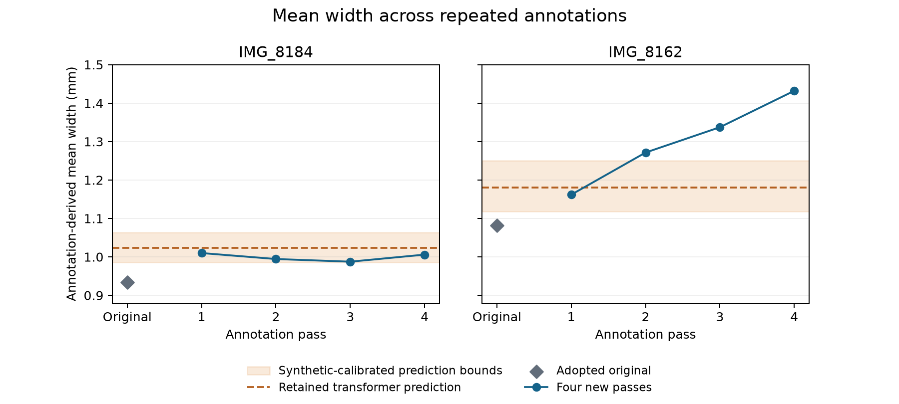
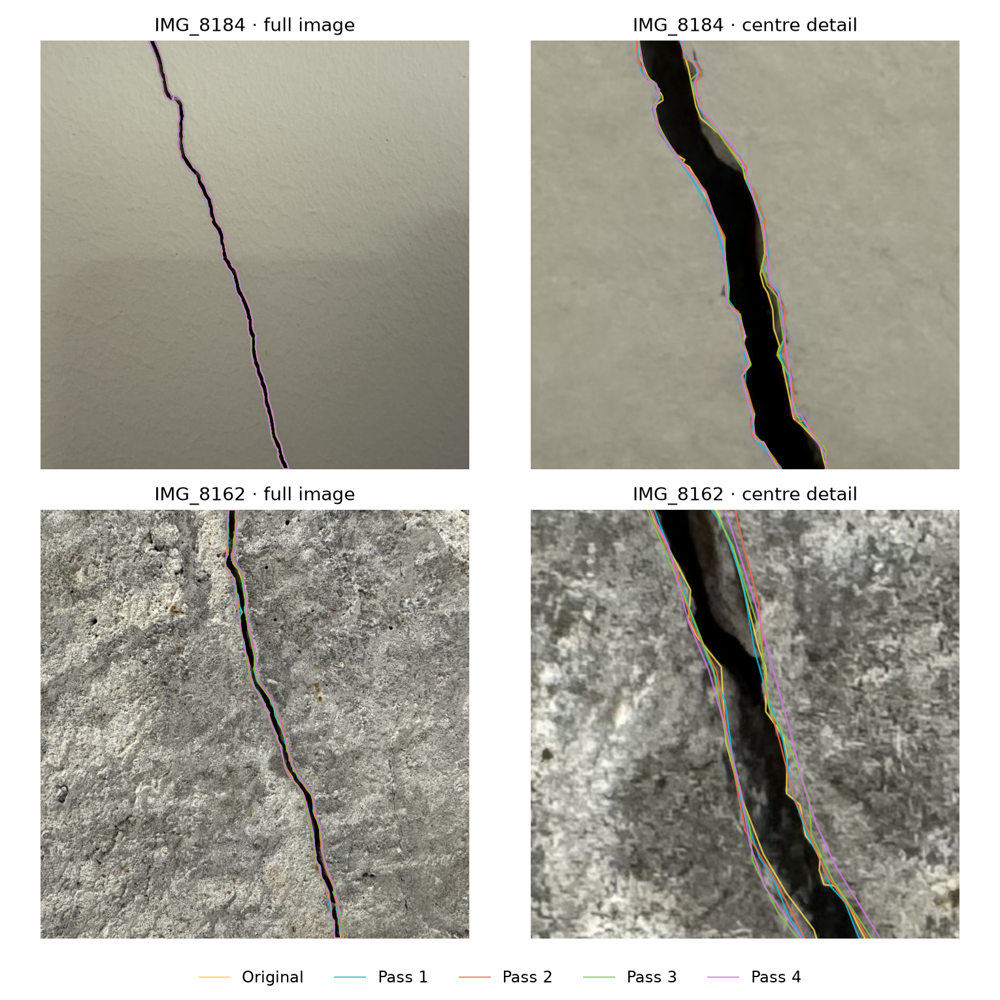

# Repeated annotation comparison: IMG_8184 and IMG_8162

Four new boundary/centreline annotations per image are compared with the adopted original, using one fixed original inference scale and the unchanged reference calculations. No model inference or reference replacement is made in this study.

## Mean width

| Image | Five-annotation mean (mm) | Sample SD (mm) | Relative SD (%) | Four-new-only mean (mm) | Four-new-only SD (mm) |
|---|---:|---:|---:|---:|---:|
| IMG_8184 | 0.9863 | 0.0305 | 3.09 | 0.9994 | 0.0103 |
| IMG_8162 | 1.2567 | 0.1389 | 11.05 | 1.3005 | 0.1136 |
| IMG_8579 | 1.1760 | 0.0859 | 7.30 | 1.2077 | 0.0562 |

IMG_8579 is the previous completed repeated-annotation study. Its values here use the prior fixed image scale for comparison. The separate Metrosert-based uncertainty example remains unchanged.

## Variability across all four quantities

Sample standard deviations divided by the five-annotation means, in percent:

| Image | Length | Mean width | Maximum width | Area |
|---|---:|---:|---:|---:|
| IMG_8184 | 0.48 | 3.09 | 2.80 | 3.47 |
| IMG_8162 | 0.22 | 11.05 | 10.64 | 10.90 |
| IMG_8579 | 0.27 | 7.30 | 13.16 | 7.18 |

## Interpretation

IMG_8184 has closely grouped new width annotations (0.987–1.010 mm), with the original at 0.934 mm. The four new passes have a width SD of 0.0103 mm, compared with 0.0305 mm when the earlier original is included. The difference between sessions is therefore material.

IMG_8162 shows progressive widening across the four new passes: 1.162, 1.271, 1.337 and 1.432 mm. Area also increases, while new centreline lengths remain close (SD 0.0364 mm). The operator reports varying starting location and tracing direction between passes. The ordered values are reported descriptively and are not treated as proof of dependence or independence.

The observations support reporting image-specific annotation variability. They do not establish a general uncertainty for all cracks or prove that surface type caused the differences. The within-operator SD describes the observed spread, not absolute annotation accuracy or common boundary bias.

For a hypothetical mean of independent repeats, s/√5 is 0.01365 mm for IMG_8184 and 0.06210 mm for IMG_8162 mean width. These are conditional calculations, not validated uncertainty values for the two means. The reduction applies only to a mean formed under independent-repeat assumptions. The [individual-reference uncertainty study](../reference_uncertainty/README.md) uses the full observed annotation covariance without this reduction.

## Comparison with retained predictions

The five-annotation mean is a sensitivity analysis, not a replacement for the adopted image reference. Predictions and synthetic-validation bounds are unchanged. Interval inclusion does not demonstrate real-domain coverage.

| Image | Quantity | Five-annotation mean | Prediction | Bounds | Difference from mean (%) | Mean within bounds |
|---|---|---:|---:|---|---:|---|
| IMG_8184 | centerline_length | 89.4173 | 85.4662 | [82.2727, 89.1695] | -4.42 | no |
| IMG_8184 | mean_width | 0.9863 | 1.0229 | [0.9861, 1.0635] | +3.71 | yes |
| IMG_8184 | max_width | 1.1939 | 1.1417 | [1.0882, 1.2054] | -4.37 | yes |
| IMG_8184 | crack_area | 88.2043 | 88.4273 | [84.5395, 92.8127] | +0.25 | yes |
| IMG_8162 | centerline_length | 80.8163 | 78.2028 | [73.7937, 83.4953] | -3.23 | yes |
| IMG_8162 | mean_width | 1.2567 | 1.1799 | [1.1178, 1.2499] | -6.11 | no |
| IMG_8162 | max_width | 1.6687 | 1.4332 | [1.3182, 1.5685] | -14.11 | no |
| IMG_8162 | crack_area | 101.5480 | 90.5519 | [85.6541, 96.4448] | -10.83 | no |

## Geometry checks and provenance

All ten boundary polygons have no detected self-intersections. Interior sampled centreline stations remain within their boundary polygons. Recalculated original values match their retained references to 10⁻⁹ in the respective physical units. Native photograph coordinates and a common homography are used within each image. Width probes are not substituted for polygon-derived mean width.

One new trace (IMG_8184 pass 2) retains an “in-progress” UI status, but has a finished boundary, a finished centreline and no unfinished points. It is included following the author’s completion confirmation; no source metadata was edited. All other new traces are marked complete.

The adopted originals and new passes have different session histories and earlier prediction exposure. They are not a fully blinded study. All passes are retained, including those with less favourable prediction agreement.

## Reproduction

Run `python3 analyze.py` to regenerate `results.json`, then `python3 make_report.py` to regenerate this report and the figures. Dependencies: NumPy, Pillow and Matplotlib. The fixed homographies, frozen annotations, original photographs and retained prediction vectors are in `inputs/`. `input_checksums.json` verifies the input copies. The geometry code uses 0.05 mm width-station spacing and a 1 mm tangent window, matching the existing reference procedure.

Complete per-pass values, covariance matrices, single-annotation SD, conditional uncertainty of the mean, and the four-new-only sensitivity are saved in `results.json`. The [Metrosert uncertainty example](../uncertainty_example/README.md) documents the calibration chain separately. No files have been published.
