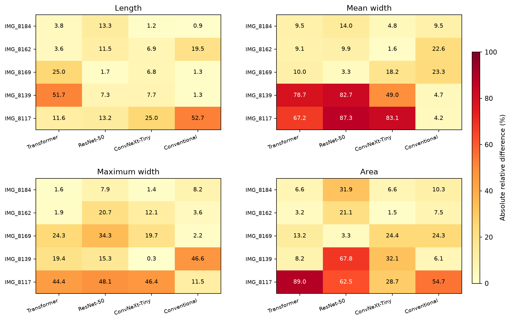
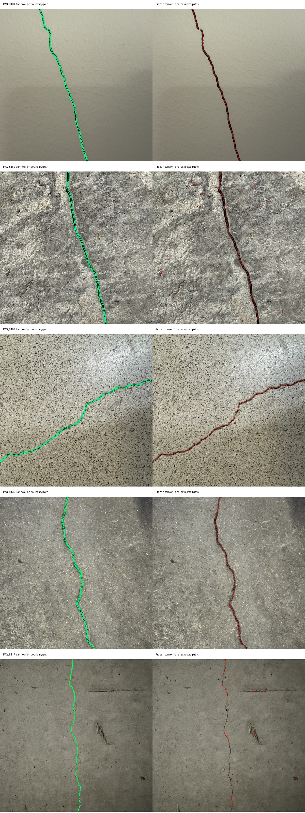

# Retained-model comparison on five real cracks

7 November 2026. Local review study. No training, field-specific tuning or publication.

## Scope and protocol

The inventory contains 79 photograph files, including calibration-target images. Five have complete adopted centreline and boundary annotations and paired directional scale maps: IMG_8184, IMG_8162, IMG_8169, IMG_8139 and IMG_8117. The author identified these as separate cracks on different surfaces. Eligibility was fixed before this comparison. Earlier annotation versions are not extra cases. Images with sparse manual width readings but no complete four-measurand annotations are not part of this paired panel.

This is a purposive existing sample. Earlier selection and annotation were informed by differing exposure to transformer predictions. In particular, the adopted IMG_8162 boundary interpretation was refined after its original inference. We do not claim a fully blind annotation study or representative sampling. No new annotation was adjusted during this comparison. Additional acquisition remains planned.

All methods receive identical full-frame 1024 × 1024 RGB and directional physical-scale maps. The learned models receive the geometric mean scale as their fourth channel. We verified input tensor hashes across methods, complete annotation geometry and matching scale/annotation homographies. The two existing single centreline stations lying outside their boundaries in IMG_8162/8139 retain the original handling in maximum-width sampling. No annotation changes were made.

Transformer epoch 49, ResNet-50 epoch 47 and ConvNeXt-Tiny epoch 50 use the reviewed weight files, original normalization and batch-one CPU float32 inference. ResNet uses per-image BatchNorm with dropout disabled. Model weights and buffers are checked unchanged. Conventional settings remain closing_s15_r0.35_c0, selected on synthetic validation. Synthetic corrected-reference factors and residual radii are applied without using field references to fit them.

## Aggregate results

Mean absolute relative differences against annotation-derived references, in percent. These are descriptive averages over five cases, not field population estimates.

| Method | Length | Mean width | Maximum width | Area |
|---|---:|---:|---:|---:|
| Transformer | 19.14 | 34.90 | 18.30 | 24.03 |
| ResNet-50 | 9.40 | 39.42 | 25.26 | 37.28 |
| ConvNeXt-Tiny | 9.51 | 31.34 | 15.97 | 18.69 |
| Conventional | 15.16 | 12.87 | 14.41 | 20.58 |

No method has the smallest average difference for every measurand. The transformer’s synthetic advantage does not consistently carry over to this panel. ResNet-50 has the smallest mean length difference, ConvNeXt-Tiny the smallest area difference, and the conventional method the smallest mean- and maximum-width differences. The small difference between ResNet and ConvNeXt length averages is not a statistically established ordering.

## Prediction intervals

The following counts describe how many of five annotation references lie within the synthetic-calibrated bounds for each quantity. They are not estimates of population coverage. Widths are averaged over the same five cases (mm for length/widths and mm² for area).

| Method | Inclusion counts L / mean w / max w / A | Mean interval widths L / mean w / max w / A |
|---|---|---|
| Transformer | 2/5 / 0/5 / 2/5 / 2/5 | 12.166 / 0.125 / 0.188 / 10.964 |
| ResNet-50 | 3/5 / 1/5 / 1/5 / 1/5 | 25.255 / 0.192 / 0.290 / 30.914 |
| ConvNeXt-Tiny | 4/5 / 2/5 / 3/5 / 4/5 | 40.471 / 0.207 / 0.305 / 37.329 |
| Conventional | 4/5 / 5/5 / 5/5 / 5/5 | 106.318 / 0.593 / 2.820 / 79.104 |

Across the 20 case–quantity comparisons, inclusion counts are 6 for the transformer, 6 for ResNet-50, 13 for ConvNeXt-Tiny and 19 for the conventional method. These 20 comparisons are correlated within images and are not independent trials. Higher inclusion accompanies substantially wider bounds. Conventional mean length interval width is about 106 mm, compared with 12 mm for the transformer. Inclusion alone therefore does not establish a more precise measurement system. No bounds include annotation or full scale-chain uncertainty.

## Per-image results

### IMG_8184

| Method | Length difference (%) | Mean-width difference (%) | Max-width difference (%) | Area difference (%) |
|---|---:|---:|---:|---:|
| Transformer | 3.80 | 9.50 | 1.56 | 6.56 |
| ResNet-50 | 13.27 | 14.01 | 7.85 | 31.87 |
| ConvNeXt-Tiny | 1.19 | 4.81 | 1.37 | 6.62 |
| Conventional | 0.91 | 9.45 | 8.18 | 10.28 |

### IMG_8162

| Method | Length difference (%) | Mean-width difference (%) | Max-width difference (%) | Area difference (%) |
|---|---:|---:|---:|---:|
| Transformer | 3.61 | 9.10 | 1.86 | 3.21 |
| ResNet-50 | 11.48 | 9.88 | 20.74 | 21.07 |
| ConvNeXt-Tiny | 6.86 | 1.64 | 12.07 | 1.53 |
| Conventional | 19.55 | 22.64 | 3.64 | 7.52 |

### IMG_8169

| Method | Length difference (%) | Mean-width difference (%) | Max-width difference (%) | Area difference (%) |
|---|---:|---:|---:|---:|
| Transformer | 25.02 | 10.04 | 24.34 | 13.22 |
| ResNet-50 | 1.70 | 3.26 | 34.32 | 3.25 |
| ConvNeXt-Tiny | 6.76 | 18.17 | 19.72 | 24.39 |
| Conventional | 1.29 | 23.33 | 2.17 | 24.32 |

### IMG_8139

| Method | Length difference (%) | Mean-width difference (%) | Max-width difference (%) | Area difference (%) |
|---|---:|---:|---:|---:|
| Transformer | 51.68 | 78.67 | 19.37 | 8.15 |
| ResNet-50 | 7.32 | 82.67 | 15.32 | 67.76 |
| ConvNeXt-Tiny | 7.73 | 48.98 | 0.30 | 32.14 |
| Conventional | 1.34 | 4.67 | 46.57 | 6.07 |

### IMG_8117

| Method | Length difference (%) | Mean-width difference (%) | Max-width difference (%) | Area difference (%) |
|---|---:|---:|---:|---:|
| Transformer | 11.59 | 67.17 | 44.38 | 89.02 |
| ResNet-50 | 13.25 | 87.27 | 48.08 | 62.46 |
| ConvNeXt-Tiny | 25.00 | 83.07 | 46.37 | 28.74 |
| Conventional | 52.69 | 4.24 | 11.50 | 54.69 |

The IMG_8117 case is retained despite large disagreements. Its annotated crack is thin and a non-crack horizontal streak is visible in the scene. The conventional pipeline captures only part of the annotated length and also retains some non-crack components. Earlier transformer auxiliary maps also included the horizontal streak. These observations do not prove which image regions determine the learned scalar outputs.

## Reproduction and limitations

The four previously published transformer central predictions reproduce within 0.000020 in their physical units. Reference values reproduce exactly. This is numerical parity across saved/CPU execution, not a new training experiment. Model execution times per image are recorded below and exclude image reading, preprocessing and model loading. Hardware/device and settings are in each run record.

- Transformer: mean 1.19 s per image, range 1.15–1.33 s.
- ResNet-50: mean 0.39 s per image, range 0.38–0.41 s.
- ConvNeXt-Tiny: mean 3.40 s per image, range 3.35–3.51 s.
- Conventional: mean 0.12 s per image, range 0.10–0.13 s.

The current scale maps are provisional pending the independent glass-target calibration. Reference annotation uncertainty is unquantified, and model inputs and reference calculations share scale. These comparisons do not establish traceable end-to-end uncertainty or stable model rankings. The training-seed part of R1.C5 remains open. See [training repeat assessment](training_repeat_assessment.md).

The raw paired values and bounds are in `comparison.csv`, target-wise statistics in `summary.csv`, and source, weight and protocol checks in the JSON records. Original inputs, inference outputs and previous studies remain unchanged.
