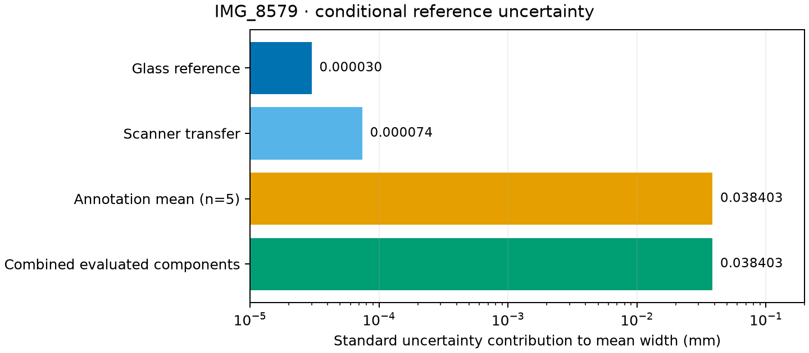

# Scale and annotation uncertainty example

This study evaluates mean crack width in IMG_8579 using independent glass-target measurements, scanner characterization, a measured paper target and five annotations. The resulting reference mean is **1.1761 mm**. The combined standard uncertainty of the evaluated components is **0.0384 mm**, assuming independent annotation repeats and the scale-transfer assumptions below. Annotation variability dominates this component budget.

The unchanged transformer, supplied with the updated scale, predicts **1.1157 mm** with synthetic-validation bounds **[1.0682, 1.1717] mm**. These bounds remain separate from the reference uncertainty. Their real-image coverage is not established by this example.

See the [full report](REPORT.md), [reference calculations](results/reference_budget.json), [shared-scale comparison](results/shared_scale_comparison.json), [source protocol](protocol.json) and [verification](verification.json). Nothing has been published. The original study records and adopted real-image references remain unchanged by this separate example.



## Reproduction

Use Python with NumPy, OpenCV, Pillow and Matplotlib for the reference analysis. The optional [model inference package](../../inference/README.md) and reviewed transformer assets are needed only for the model sensitivity calculation.

```sh
python propagate_reference.py
python run_model_sensitivity.py --assets /path/to/reviewed/model-assets
python summarize.py
```

For a study copied outside the supplement, pass `--package /path/to/inference/src` to the model script. The scripts write derived results inside this study. They never modify images, annotations or source calibration data. The exact inference environment and checkpoint hash are in [model_scale_sensitivity.json](results/model_scale_sensitivity.json). Analysis used NumPy 2.5.4 and OpenCV 5.0.0. Inference used CPU float32, PyTorch 2.8.0, four threads and the retained transformer selected at epoch 49. No training or field fitting was performed.

## Files

- `inputs/metrosert_JD194821-001.pdf`: independent measurement report BTLL-26/084, including its dimensional results and uncertainty statement.
- `inputs/JD194821-001.pdf`: earlier manufacturer's certificate, retained to explain the previous dimensional reference.
- `inputs/scanner/`: 14 measured scan records and original detected dot coordinates. Span calculations are checked against these coordinates.
- `inputs/paper_target_01_points_previous.npz`: original measured paper-dot pixel coordinates and previous physical coordinates. The scanner pixels, not nominal paper dimensions, are the transfer input.
- `inputs/photo_grid_points.npz`: detected target-photo points and their grid indices.
- `inputs/annotations/`: original trace plus four new traces, preserved separately.
- `inputs/IMG_8578.jpeg` and `inputs/IMG_8579.jpeg`: paired target and surface photographs.
- `results/`: updated calibration, all annotation quantities, covariance matrices, component budgets and model sensitivity results.
- `figures/`: component budget and annotation comparison.
- `input_checksums.json`: frozen inputs. `checksums.json` inventories the prepared supplement.

The dense `results/scale_vectors.npz` intermediate is regenerated by the reference script and is omitted from the repository copy. It is not an additional measured input.

Calibration documents are third-party source records. Their inclusion does not imply that the repository's software or dataset licence changes their ownership or terms.
